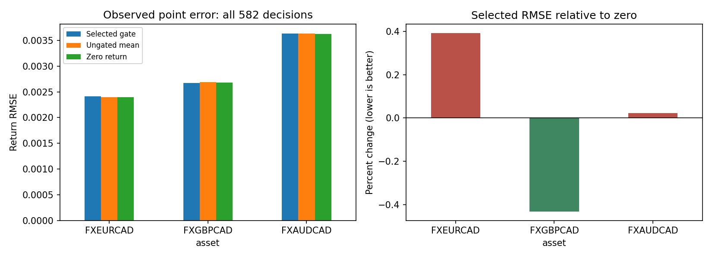

# Regime-aware FX forecasting

A causal forecasting pipeline for Bank of Canada reference exchange rates. It compares regime-conditioned tree models, regularized forecasts and zero return, with chronological validation, delayed labels and residual intervals. Reference rates are not executable trading quotes.

## Run

Run these commands from this repository's root.

Use Python **3.13.15** for the verified reference runtime and a separate environment. Installing this repository with other generic `src` projects in one environment is unsupported.

```powershell
python -m venv .venv
.\.venv\Scripts\Activate.ps1
python -m pip install -r requirements.txt
python -m pip install -e ".[dev,notebooks]"
python -m pytest -q
python -m src.data.gated_fetch mean --output data/processed/development-through2024.json
python train.py selected --snapshot data/processed/development-through2024.json --output models/my-gated-mean
$freeze = (Get-FileHash models/my-gated-mean/mean-freeze.json -Algorithm SHA256).Hash.ToLower()
python -m src.data.gated_fetch calibration --run models/my-gated-mean --policy docs/gated-forecast-policy.json --freeze-sha256 $freeze --output data/external/gated-development/source.json
python -m src.gated_workflow calibrate --run models/my-gated-mean --parent data/external/gated-development/source.json --policy docs/gated-forecast-policy.json --freeze-sha256 $freeze --output models/my-gated-calibration
```

These commands fetch the complete source, fit the fixed validation-selected mean model through 2024, freeze its identity, then fetch 2025 data for separate interval calibration. Existing output paths are rejected. Provider revisions stop reproduction rather than silently using cached reference data. On Linux/macOS activate `.venv/bin/activate`; equivalent commands are available through the Makefile.

Forecast new observations from a Bank of Canada JSON snapshot containing the same three series:

```powershell
$policy = (Get-FileHash docs/gated-forecast-policy.json -Algorithm SHA256).Hash.ToLower()
$receipt = (Get-FileHash models/my-gated-calibration/calibrated/receipt.json -Algorithm SHA256).Hash.ToLower()
python -m src.gated_workflow forecast --model models/my-gated-calibration/calibrated --snapshot data/new-observations.json --policy docs/gated-forecast-policy.json --policy-sha256 $policy --receipt-sha256 $receipt --output data/reports/my-forecasts.csv
```

Forecasting does not calculate accuracy. Data, trained bundles and prediction files remain local.

## Notebooks and results

Launch `python -m jupyter lab` from the activated environment.

- [Source timing and real-data EDA](notebooks/01_source_timing_and_eda.ipynb)
- [Main causal models and training](notebooks/02_main_causal_models_and_training.ipynb): visible feature/fit/calibration logic and executed validation plots.
- [Observed errors and intervals](notebooks/03_observed_errors_and_intervals.ipynb)
- [Selected model training and calibration](notebooks/04_selected_forecast_training_and_calibration.ipynb): complete training and calibration cohorts, chronological validation, and fresh-training verification.

On all 582 matured three-asset decisions in the observed 2026 cohort, the selected volatility-gated ridge has RMSE **0.00295114**, versus **0.00295666** for ungated ridge and **0.00295177** for zero return. The difference from zero is tiny, varies by asset and does not establish a trading edge. Its nominal 90% intervals cover **88.32%** of targets.

See [Report.md](Report.md) and [source/terms notes](docs/datasets.md). The mean model trains through 2024; 2025 calibrates intervals separately. Features are causal, targets mature after delayed execution, and training boundaries purge future labels. Current API snapshots are not as-published historical vintages. Data, predictions, state histories, weights and secrets stay ignored.


