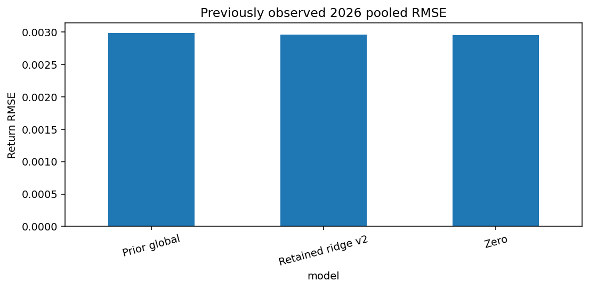

# Regime-aware FX forecasting

A causal forecasting pipeline for Bank of Canada reference exchange rates. It compares regime-conditioned tree models, regularized forecasts and zero return, with chronological validation, delayed labels and residual intervals. Reference rates are not executable trading quotes.

## Run

Run these commands from this repository’s root.

Use a separate environment; installing this repository with other generic `src` projects in one environment is unsupported.

```powershell
python -m venv .venv
.\.venv\Scripts\Activate.ps1
python -m pip install -e ".[dev,notebooks]"
python -m pytest -q
python train.py shared --output models/NEW_SHARED_RUN
python -m src.models.uncertainty forecast --output models/uncertainty-v2 --panel YOUR_COMPLETE_PANEL.csv --predictions data/interim/NEW_FORECASTS.csv
```

The training command uses the frozen historical caches described in the report and refuses existing output paths. The notebooks show production data acquisition. Forecasting requires an ignored local checkpoint and a complete ordered panel; it does not calculate test accuracy. On Linux/macOS activate `.venv/bin/activate`.

## Notebooks and results

Launch `python -m jupyter lab` from the activated environment.

- [Source timing and real-data EDA](notebooks/01_source_timing_and_eda.ipynb)
- [Main causal models and training](notebooks/02_main_causal_models_and_training.ipynb): visible feature/fit/calibration logic and executed validation plots.
- [Observed errors and intervals](notebooks/03_observed_errors_and_intervals.ipynb)

On the previously observed three-asset 2026 cohort, retained ridge RMSE is **0.00295666**, versus prior global **0.00298725** and zero **0.00295177**. Zero remains slightly better. Shared, blended and recency-weighted followups failed the prespecified adoption gate. Fixed residual calibration also beat rolling alternatives on 2025 validation. These results do not establish trading profit.

See [Report.md](Report.md), the [experiment ledger](docs/experiments.md) and [source/terms notes](docs/datasets.md). The mean model trains through 2024; 2025 calibrates intervals separately. Features are causal, targets mature after delayed execution, and training boundaries purge future labels. Current API snapshots are not as-published historical vintages. Data, predictions, state histories, weights and secrets stay ignored.


